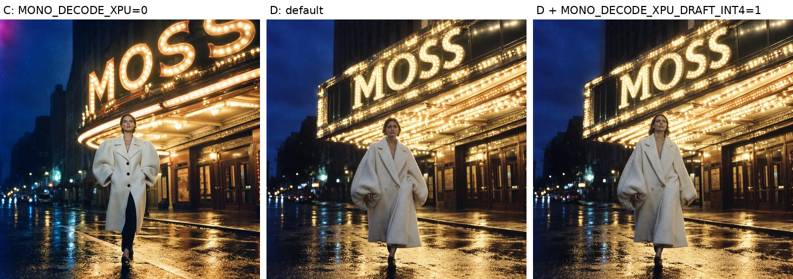
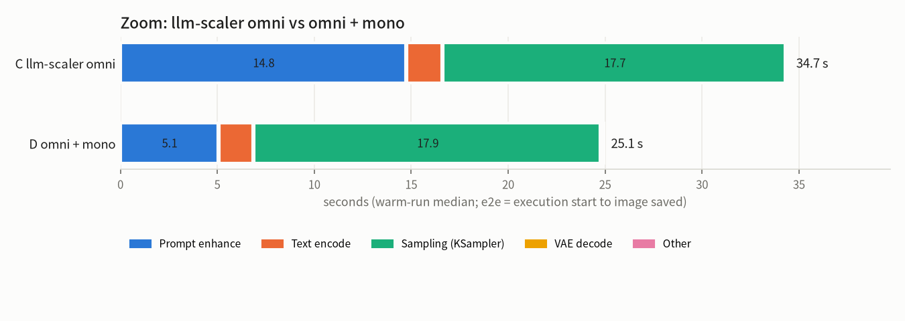
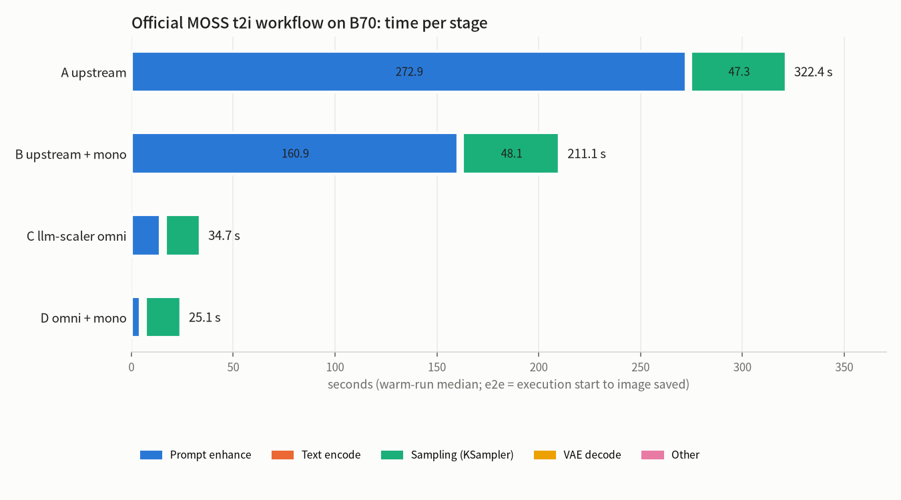

# comfy-mono-decode-xpu

Decode kernels for ComfyUI prompt enhance (`TextGenerate` / `TextGenerateV2` with MTP) on Intel XPU
(Xe2 / BMG, Arc Pro B70), for Qwen3.5-9B W4A8 text encoders.

The hooks sit at the model's decode step, so official workflows and templates speed up without new
nodes. Numerical checks compare each kernel with the operator chain it replaces, using identical
inputs, weights, dtype and layout. Two parts differ by design:
- The decode attention (tree-verify rows and the MTP draft row) uses DPAS and a split by the actual
  context length instead of Kitchen's structure. It is checked against an fp64 reference, with
  Kitchen's own error on the same inputs as the bound (`MONO_DECODE_XPU_ATTN_DPAS=0` restores the
  bit-identical port).
- The fused MTP draft head keeps the eager arithmetic but not its reduction order. Drafts only
  propose tokens; the verify decides every output token.

The v0.43 fixed-tree results (Results, Legacy) preserved the generated token IDs. Workflow
qualification checks the generated prompt and final image; it does not require whole-generation token
identity across different layouts or backend dispatch.

ComfyUI v0.45's `CombinedLinear` is supported: hooks borrow per-projection views of the current
prefetched weight, and release those views with the forward call. Inactive groups use the ordinary
cast path.

## Supported models and validated workflows

Any workflow whose prompt enhance runs Qwen3.5-9B W4A8 (`qwen3.5_9b_w4a8_gptq`) through `TextGenerate`
or `TextGenerateV2` with MTP is supported. The hooks sit at the model's decode step, independent of the
workflow. Other text encoders are left untouched.

Validated on Arc Pro B70:

| official template | ComfyUI | validation |
|---|---|---|
| MOSS Image (`image_moss_image_t2i`) | v0.45 (and v0.43) | performance and output, see Results |
| MiniMax H3 Image (`image_minimax_h3_image_t2i`) | v0.45 | performance and output in DynamicVRAM, see Results (prompt-enhance decode about 140–149 tok/s on every image; `MONO_DECODE_XPU=0`: 24–28 tok/s); the default workflow also completes in prefetch and ordinary-memory modes |

## Results

All numbers are from one Arc Pro B70. The current results (ComfyUI v0.45, 2026-11-13 and 2026-11-16) use the
environment in Requirements with ComfyUI-OmniXPU from intel/llm-scaler main `066f0db`. The Legacy
results keep their original v0.43 environment (the llm-scaler-omni 0.2.0-b3 ComfyUI image).

### MOSS-Image (ComfyUI v0.45, 2026-11-13)

Workflow: the official `image_moss_image_t2i` template (identical in v0.43 and v0.45), replayed from the
frontend's saved Run request with the KSampler seed fixed to 42: 1024x1024, 25 steps, CFG 2.5,
er_sde/simple, DynamicVRAM, prompt enhance with the template defaults (`auto` MTP, sampling on).
Each configuration runs on a fresh server: one cold run (text seed 0), three warmups (101/102/103) and
three measured runs (text seeds 1/2/3). Every run executes prompt enhance, conditioning, sampling and
VAE again. Means over the measured runs:

| | C `MONO_DECODE_XPU=0` | D default | D + `MONO_DECODE_XPU_DRAFT_INT4=1` |
|---|---:|---:|---:|
| end to end | 35.06 s | 24.35 s (**-30.5%**) | 24.30 s (-30.7%) |
| end to end, cold run | 45.67 s | 32.98 s | 32.67 s |
| prompt enhance | 14.94 s | 4.23 s (-71.7%) | 4.12 s (-72.4%) |
| prompt-enhance decode | 23.4 tok/s | 121.9 tok/s (**5.2x**) | 127.3 tok/s (5.4x) |
| everything else (encode, sampling, VAE) | 20.1 s | 20.1 s | 20.2 s |
| enhanced prompt tokens (seeds 1/2/3) | 314 / 355 / 279 | 297 / 365 / 355 | 297 / 365 / 355 |

All 21 runs completed and saved an image (the measured ones checked by eye). With the experimental two-stage draft lm_head, the three
measured prompts are the same token sequences as D's (same sha), only faster. C and D write
different, equally valid prompts: under `auto` the tree follows each configuration's speed, and the
decode attention is no longer bit-identical to Kitchen (see the top of this page).

Re-checked with the current source on 2026-11-16 (same procedure, default switches): decode 127.4 tok/s,
prompt enhance 3.92 s and end to end 23.94 s over the measured runs; every run used the tile-major
weight copy.



### MiniMax H3 Image (ComfyUI v0.45, 2026-11-16)

Workflow: the official `image_minimax_h3_image_t2i` default workflow, replayed from the frontend's saved
Run request: prompt enhance with `thinking` on, sampling on, `auto` MTP, up to 8192 tokens; 2048x2048,
6 steps, CFG 1, euler/simple, KSampler seed 42; DynamicVRAM. Same procedure as MOSS-Image: a fresh
server per configuration, the first image (text seed 0), three warmups (101/102/103) and three
measured runs (text seeds 1/2/3), every run executing prompt enhance, conditioning, sampling and VAE
again. Prompt-enhance decode:

| tok/s | previous release (`5483586`) | default | + `MONO_DECODE_XPU_DRAFT_INT4=1` |
|---|---:|---:|---:|
| first image | 141.0 | 144.5 | 159.4 |
| later images, measured mean | 119.8 | **146.1** | 161.1 |
| later images, all six | 115.5-124.9 | 140.1-149.1 | 152.0-163.5 |
| post-block weights after the first image | checkpoint row-major | tile-major copy | tile-major copy |
| enhanced prompt tokens (seeds 1/2/3) | 4542 / 3702 / 3733 | 6240 / 6168 / 5106 | 8192 / 5647 / 7581 |

From the second image on, the diffusion model stays resident (about 20 GB of DynamicVRAM pages)
while the prompt is enhanced again. The previous release sized the per-generate tile-major weight
copy (3.9 GB) by physically free memory only, found none, and ran the post blocks on the
checkpoint's row-major weights, about 2 ms slower a step. The current source also counts the resident
pages of inactive models that the XPU allocator hook can reclaim, so every image gets the copy; the
diffusion model's pages come back during sampling without a measurable cost. MOSS-Image always had
room for the copy.

H3 enhanced prompts run to several thousand tokens (thinking), so decode dominates prompt enhance;
tok/s follows the generated text through the tokens accepted and the drafts run per step. With
`MONO_DECODE_XPU=0` the same decode runs at 23.7-27.8 tok/s (prompt enhance alone, 2026-11-13).
All 21 runs completed and saved an image (checked by eye). Thinking sometimes fills all 8192
tokens without writing the caption (here warmup seed 103 with the default switches and measured
seed 1 with `DRAFT_INT4`); the image is then generated from an empty prompt. That is an open issue
of prompt enhance's thinking length, not a decode error.

### Legacy

<details><summary>H3 prompt enhance alone (ComfyUI v0.45, 2026-11-13); ComfyUI v0.43 results (2026-11-11 / 2026-11-12): MOSS-Image C/D comparison, official showcase with images, upstream reference groups, TextGenerate decode alone</summary>

### MiniMax H3 Image prompt enhance alone (ComfyUI v0.45, 2026-11-13)

Prompt enhance ran on a server without the diffusion model loaded, as for the first image of the
workflow; the current results above measure the whole workflow.

The official H3 Image default workflow (`thinking` on, sampling on, `auto` MTP, up to 8192 tokens),
prompt enhance alone, decode tok/s over text seeds 0-3 (0-1 for `MONO_DECODE_XPU=0`); the default and
`DRAFT_INT4` ranges cover two and three such runs:

| `MONO_DECODE_XPU=0` | previous release (`d42987e`) | default | + `MONO_DECODE_XPU_DRAFT_INT4=1` |
|---:|---:|---:|---:|
| 23.7-27.8 | 115.0-117.1 | 133.0-141.6 | 145.8-152.3 |

H3 enhanced prompts run to several thousand tokens (thinking), so decode dominates prompt enhance.
Between runs the per-step device time stays the same (verify about 11.6 ms, tail 2.2 ms, a draft
about 2.8 ms, or 2.1 ms with `DRAFT_INT4`); tok/s follows the generated text through the tokens
accepted and the drafts run per step.

### MOSS-Image C/D comparison (ComfyUI v0.43, 2026-11-12)

Measured on the pre-release development source with the default-on stack (before the fused Q/K norm + RoPE kernel).
C explicitly sets `MONO_DECODE_XPU=0`; D leaves it unset and exercises the default-on stack.
Each C-before / D / C-after block uses a fresh server, excludes one cold run and three warmups,
and measures three forced prompt expansions (text seeds 1/2/3, KSampler seed 42 fixed).
The official MOSS template keeps 1024x1024, 25 steps, CFG 2.5 and er_sde/simple, in DynamicVRAM mode.

| MTP | C paired mean | D mean | end-to-end change | wins | C before/after drift |
|---|---:|---:|---:|---:|---:|
| official auto | 36.395 s | 24.915 s | -31.54% | 3/3 | +0.936% |
| fixed tree4s1m8 | 34.884 s | 24.738 s | -29.09% | 3/3 | -0.043% |

With the fixed tree, full token sequences match across C/D/C (304/262/372 tokens).
Prompt enhancement is 15.205 -> 5.050 s;
decode is 13.666 -> 3.486 s (-74.49%).
Auto timings include adaptive-tree and text-length differences and do not establish identical-work speedup.
All 42 complete UI executions produced valid images; all 14 default-on generations ended with no live
tile references or disabled paths. These are development source-overlay measurements.

### Official MOSS-Image showcase (ComfyUI v0.43, 2026-11-11)

The measurements below predate the failure-recovery and cache-lifetime fixes. They retain their
original cold/warm sampling scheme and medians; the 2026-11-12 comparison above uses paired means.

Workflow: the official `image_moss_image_t2i` template, unchanged except that the KSampler seed is
fixed to **42** (the template randomizes it). Prompt enhance uses the template defaults: Qwen3.5-9B
W4A8, `auto` MTP, sampling on. **C** uses ComfyUI-OmniXPU, Kitchen XPU and DynamicVRAM with mono
disabled (`MONO_DECODE_XPU=0`); **D** uses the same stack with mono enabled (now the default, or
explicitly `MONO_DECODE_XPU=1`). Each runs on a fresh server: one cold run, then three warm runs.
The warm runs change only the TextGenerate sampling seed (1, 2, 3; the same seeds for both
configurations), so prompt enhance and the image stages run again while the model loaders stay
cached.

**Mono does not change the output.** With the MTP tree fixed (`tree4s1m8`), C and D generate the
identical enhanced prompt (362 tokens, token sha `adaeae7bb8a40903`), and the images match to the eye.
What remains is the image stage's own run-to-run noise (PSNR 30.9 dB; two identical stock runs
give about 29 dB). D gets there faster: end to end 45.8 → 33.8 s, prompt enhance
18.6 → 6.9 s (cold runs).

| C llm-scaler omni, fixed tree | D omni + mono, fixed tree |
|---|---|
|  |  |

<details><summary>The shared enhanced prompt (C and D, fixed tree)</summary>

> Cinematic night street photograph of a model wearing an exaggerated balloon-sleeve white wool coat walking directly toward the camera. The model has a slender build, pale skin with a subtle 35mm film grain texture, and long dark hair that flows slightly in the evening breeze. Her posture is confident with shoulders back, one hand lightly brushing against the coat's sleeve while the other holds a small clutch close to her hip. She wears opaque black tights and chunky black leather ankle boots that click rhythmically on the wet asphalt.
> >
> > The scene is dominated by a huge illuminated theatre marquee towering above the street, its face packed with vintage-style bulbs spelling "MOSS" in tall, bold capital letters. The warm tungsten glow from the marquee casts a golden halo on the model's face and shoulders, contrasting sharply with the deep cold blue of the surrounding night sky. Long, distorted reflections of the marquee's lights stretch across the rain-slicked ground, creating a shimmering path of amber and gold beneath the model's feet.
> >
> > The composition utilizes a low camera angle to emphasize the height of the marquee and the imposing presence of the balloon sleeves. The background features blurred storefronts and distant streetlights that fade into the misty atmosphere, keeping the focus tight on the central figure and the glowing sign. The lighting is dramatic, with hard shadows falling behind the model against the wet pavement, enhancing the moody, noir aesthetic. The overall palette consists of high-contrast whites, deep blues, and rich amber tones, rendered with a grainy, analog film look that adds depth and texture to the entire image. The "MOSS" sign is positioned high in the upper frame, clearly readable against the dark sky, anchoring the scene in a specific urban location.

</details>

**Speed with the official defaults (`auto` MTP)**

| | C llm-scaler omni | D omni + mono | change |
|---|---|---|---|
| end to end, cold | 43.4 s | 32.7 s | -25% |
| end to end, warm median | 34.7 s | 25.1 s | **-28%** |
| prompt enhance, warm median | 14.8 s | 5.1 s | -66% |
| prompt-enhance decode | 22.5 tok/s | 106.9 tok/s | **4.75×** |
| sampling (KSampler), warm | 17.7 s | 17.9 s | unchanged |
| peak VRAM | 15.1 GB | 18.4 GB | +3.3 GB tile copy, freed after each generate |



Nearly all of the saved time is prompt enhance. Prompt-enhance seconds depend on how long the
enhanced prompt is (265–450 tokens across these runs). Decode tok/s normalizes output length, but context length and speculative-tree work still affect it.

Under `auto`, the enhanced prompt itself depends on speed. `auto` chooses the speculative tree from
measured draft and verify times (`best_widths` in ComfyUI's qwen35), and with sampling on the tree
shape decides how the seeded random stream is consumed. So C and D write different, equally valid
prompts here, while with the fixed tree above they are identical.

Images cannot be compared bit for bit, even within one configuration. Text encoding varies by
~2e-4 between identical calls, and sampling adds its own noise. The images are for visual
comparison only.

<details><summary>Reference: plain upstream ComfyUI with and without mono</summary>

A = `OMNIXPU_ENABLE=0 MONO_DECODE_XPU=0` (upstream ComfyUI + comfy-kitchen; upstream comfy-aimdo has no XPU
DynamicVRAM). B = A + `MONO_DECODE_XPU=1`. Both are slow, so they are reference only: A has one
warm run, and neither was run with the fixed tree.

| group | e2e cold | e2e warm (median) | prompt enhance warm | decode tok/s | sampling |
|---|---|---|---|---|---|
| A upstream | 388.2 s | 322.4 s | 272.9 s | 1.1 | 47.3 s |
| B upstream + mono | 163.3 s | 211.1 s | 160.9 s | 2.5 | 48.1 s |



In B, mono reproduces the OmniXPU numerics, not upstream eager, so its text differs from A's. Mono
also does not replace upstream's other eager parts (lm_head, draft block, embedding), so the B speedup
is limited. Sampling takes about 48 s instead of 18 s because upstream lacks OmniXPU's UNet kernels.

All four groups, official `auto` MTP, cold run (TextGenerate sampling seed 0, KSampler seed 42):

| A upstream | B upstream + mono |
|---|---|
|  |  |
| **C llm-scaler omni** | **D omni + mono** |
|  |  |

The four enhanced prompts describe the same scene, but they are not identical, so the image details
differ. Under `auto` the tree follows each configuration's speed, and the upstream and OmniXPU kernels
also differ numerically. C and D with the fixed tree, at the top of this section, are the
like-for-like comparison.

</details>

### TextGenerate decode alone (ComfyUI v0.43)

Same image, `qwen3.5_9b_w4a8_gptq.safetensors`, three prompts (base / giant / adult), decode tok/s:

| mode | stock image | mono_decode_xpu | tokens |
|---|---|---|---|
| fixed tree `tree4s1m8`, resident weights | 28 / 30 / 30 | 81.5 / 95.6 / 91.2 | identical |
| fixed tree `tree4s1m8`, DynamicVRAM (default) | — | 80.3 / 93.8 / 89.6 | identical |
| official `auto` MTP, DynamicVRAM (default) | 23.5 / 21.8 / 24.2 | 93.2 / 100.3 / 106.8 | see note |

Note on `auto`: the adaptive tree reshapes itself from measured step times, so the accepted token
paths depend on speed. Exactness is therefore verified on fixed trees: the token sha256 equals the
stock image's for every prompt.

</details>

## Requirements

The base `intel/omix` image does **not** include ComfyUI. Everything here was built and measured in
the **llm-scaler-omni 0.2.0-b3 ComfyUI image for BMG**. That image is based on
`intel/omix:0.4.1-devel-ubuntu24.04` and adds ComfyUI and the XPU components below. Any environment
with the same components should behave the same.

`0.2.0-b3` is not published as an image; it exists only as a source build. To reproduce the tested
environment, build it from [intel/llm-scaler](https://github.com/intel/llm-scaler) at commit
`210b4ce991eb0ef3b0ad4c0c9f38b9806fb7e918`, following `omni/README.md`:

```bash
git clone https://github.com/intel/llm-scaler && cd llm-scaler
git checkout 210b4ce991eb0ef3b0ad4c0c9f38b9806fb7e918
cd omni && OMNI_IMAGE_REPOSITORY=llm-scaler-omni XPU_TARGET=bmg bash build.sh
# -> llm-scaler-omni:0.2.0-b3-comfyui-bmg
```

The published image `intel/llm-scaler-omni:0.2.0-b2` is older and has not been tested with this node.

| component | tested version | needed for |
|---|---|---|
| GPU | Intel Arc Pro B70 (Xe2 / BMG) | AOT target `bmg` by default; `--target` builds for another Xe2 device |
| ComfyUI | v0.43.0 (`426f5eea`) and v0.45.0 (`989d93d0`) | Qwen3.5 `TextGenerate` / `TextGenerateV2`, including prepared `CombinedLinear` weights |
| torch | 2.14.0+xpu, Python 3.12 | runtime |
| oneAPI DPC++ (`icpx`) | 2026.1.1 | building only (`install.py` sources `setvars.sh` if needed) |
| ComfyUI-OmniXPU | 0.2.0-b3 | bit-exact reference (see below) |
| comfy-kitchen + comfy-kitchen-xpu-runtime | matching 0.2.40 or 0.2.41 | operator reference |
| comfy-aimdo + comfy-aimdo-xpu-runtime | 0.6.0 + 0.6.0 | DynamicVRAM on XPU |
| omni_xpu_kernel | 0.2.0b3 (torch 2.14, bmg) | bit-exact reference |

The v0.45 functional environment uses [llm-scaler PR #790](https://github.com/intel/llm-scaler/pull/790)
at `3445059be0ba75424babe66620ea07c645673e52`, Kitchen provider
`f27f58782c51b6ab314b4cc0f6e65c8a6bafa277` and AIMDO provider
`3bc6afbcb92e10a2d4737e79d170190ed787bf89`; the 2026-11-13 results use ComfyUI-OmniXPU from
intel/llm-scaler main `066f0db` (which includes intel/llm-scaler#790 and intel/llm-scaler#793). The Legacy tables keep their original
v0.43 environment and measurement identities.

The kernels reproduce the OmniXPU / Kitchen XPU kernels bit for bit; that is the stack the
"identical tokens" claim refers to. Without OmniXPU (plain upstream ComfyUI + comfy-kitchen), the
node still installs and speeds up decode. The tokens then follow the OmniXPU numerics, not the
upstream eager kernels, and upstream comfy-aimdo has no XPU DynamicVRAM (results, groups A/B).

## Install

Install it like any custom node, into `ComfyUI/custom_nodes/`, using ComfyUI's Python environment.

### Windows portable: validated native extension

**Main integration requires a matching rebuilt extension.** Source commit `46afaf7` and its rebuilt
Windows extension passed user testing on Arc Pro B70 on 2026-11-16; no separate throughput figure
was supplied for that integration run. Main now includes
DPAS attention, device-side MTP, fused draft-head and compact layer-post kernels. The historical
`windows-aad3005-bmg` asset below is only for the indicated fix branch, not this merged main.
An old extension can import successfully yet lack functions such as `layer_post_h16`, `attn_dpas`
and `mtp_accept`. Update the Python source and its matching native extension together before testing.

**Cloning this repository does not install the native extension.** The Windows loader accepts
`.pyd` files, but Git contains only source code. If the extension is missing or cannot load,
ComfyUI can still start while Mono Decode stays inactive and prompt enhancement uses the stock path.
The `install.py` / `build_icpx.sh` source-build instructions below currently require Linux;
they are not an automatic Windows build procedure. For current main on Windows, use the
[Windows source-build procedure](#windows--oneapi-source-build) below instead of the historical ZIP.

The [Windows BMG release](https://github.com/zhm-algo/comfy-mono-decode-xpu/releases/tag/windows-aad3005-bmg)
provides the native extension used to validate source commit
[`aad3005`](https://github.com/zhm-algo/comfy-mono-decode-xpu/commit/aad3005548cc3c801f7cfa352c33f74764df68c4)
on branch `fix/windows-dynamic-vram-decode`. It is for **Windows x64, CPython 3.13,
Torch 2.14.1+xpu and Intel BMG**, tested with Python 3.13.14 on Arc Pro B70.
It is not a universal wheel or a replacement for Torch/oneAPI runtime dependencies.
Do not reuse it with another Python ABI, Torch version, GPU architecture, or changed native sources
without rebuilding and validating that combination.

Stop ComfyUI before installing. Set `$portable` to the actual directory containing both
`python_embeded` and `ComfyUI`, **not its parent directory**. For a new clone:

```powershell
$portable = (Resolve-Path -LiteralPath 'C:\path\to\ComfyUI_windows_portable').Path
git -C "$portable\ComfyUI\custom_nodes" clone --single-branch --branch fix/windows-dynamic-vram-decode https://github.com/zhm-algo/comfy-mono-decode-xpu.git
```

If the node is already cloned, keep that directory and check out the indicated branch instead.
Then download, verify, and extract the release asset:

```powershell
$archive = Join-Path $env:TEMP 'mono-decode-native-aad3005-cp313-torch214-bmg.zip'
$url = 'https://github.com/zhm-algo/comfy-mono-decode-xpu/releases/download/windows-aad3005-bmg/mono-decode-native-aad3005-cp313-torch214-bmg.zip'
Invoke-WebRequest -Uri $url -OutFile $archive
$expected = 'fea7b8210ecfd5465347bd2b65bd7229ae7d74ae839a9fefbc39379a2346b6f9'
if ((Get-FileHash -LiteralPath $archive -Algorithm SHA256).Hash -ne $expected) {
  throw 'Native extension archive checksum mismatch'
}
Expand-Archive -LiteralPath $archive -DestinationPath $portable -Force
& "$portable\python_embeded\python.exe" -s -c "import sys,torch; sys.path.insert(0,sys.argv[1]); from comfy_mono_decode_xpu import _C; print(_C.__file__)" "$portable\ComfyUI\custom_nodes\comfy-mono-decode-xpu"
if ($LASTEXITCODE -ne 0) { throw 'Native extension import failed; do not continue to inference' }
```

The ZIP contains only
`ComfyUI/custom_nodes/comfy-mono-decode-xpu/comfy_mono_decode_xpu/_C.cp313-win_amd64.pyd`.
It does not overwrite Python source, settings, workflows, or models. An import error mentioning a
"partially initialized module" can mean `_C` is missing or has an incompatible filename; it does
not by itself establish a Python circular import. A DLL-load error instead requires checking
runtime dependencies and ABI compatibility. Do not proceed until the import prints the extension
path inside the intended portable installation.

Restart ComfyUI and check its **startup** log for `[mono_decode_xpu] layer installed=True`.
With eligible Qwen3.5 decode and enough memory, generation should also report `reusing 32 tile plans`
and `cached INT8 output head`. Import success alone does not establish that the hooks are active.
The validated Windows MiniMax H3 edit run retained the full 11,541-token input, image, MTP and
sampling settings, reached approximately 83-93 tokens/s in the later decode phase, and completed
the workflow in 132.81 seconds. These are user-reported single-run observations, not a controlled
benchmark or a guarantee of identical generated tokens under adaptive MTP. A fresh clone was
also confirmed working after restoring this native extension.

### Windows / oneAPI source build

The ZIP is optional: it contains a precompiled `_C` extension, not additional source code.
Building the same source locally produces the `.pyd` that ComfyUI needs. Git clone/pull alone
does not compile it. Rebuild after native sources change, and when changing the Python ABI,
Torch version or GPU target. This procedure preserves the single compiler invocation used by
`build_icpx.sh`; do not substitute a per-file `SyclExtension` build with a separate device link.

#### Prerequisites

- Windows x64 and Visual Studio 2022 Build Tools with **Desktop development with C++**, including
  the MSVC x64 toolchain and Windows SDK.
- Intel oneAPI DPC++/C++ compiler for Windows, providing `icx.exe` and `setvars.bat`.
- A full x64 CPython installation (or its virtual environment) with development headers and
  `libs/python313.lib`, plus the **same Torch build as ComfyUI**. The tested combination was
  Python 3.13.14 and Torch 2.14.1+xpu. A portable embedded Python often lacks the development
  files; use a separate build environment in that case, without replacing ComfyUI's Python.
- The existing ComfyUI XPU runtime dependencies remain required. Compilation does not install
  Torch, ComfyUI-OmniXPU, Kitchen or AIMDO into the portable environment.

For example, install the matching Torch into an existing Python 3.13 build environment:

```powershell
& 'C:\path\to\build-venv\Scripts\python.exe' -m pip install 'torch==2.14.1+xpu' --index-url https://download.pytorch.org/whl/xpu
```

If that exact build came from a different wheel source, use that same source. Do not silently
substitute a CPU wheel or a different Torch version. The build machine need not have a B70;
running the compiled kernels and validating their results requires the matching GPU/runtime.

#### Initialize the toolchain

Open **x64 Native Tools Command Prompt for VS 2022**, then run these commands in that prompt
(adjust the oneAPI path if installed elsewhere):

```bat
set "VS2022INSTALLDIR=%VSINSTALLDIR%"
call "C:\Program Files (x86)\Intel\oneAPI\setvars.bat"
powershell -NoProfile
```

Continue in that PowerShell window so it inherits both MSVC and oneAPI environments.
Setting `VS2022INSTALLDIR` explicitly avoids oneAPI failing to discover an installed BuildTools
edition. Stop if initialization reports an error.

#### Compile and install

Stop ComfyUI first. Set the three paths below: `$portable` contains both `ComfyUI` and
`python_embeded`; `$repo` is the source checkout to build; `$python` is the full build Python.
Use the main checkout for this procedure, not the historical fix branch. For a new checkout,
clone `https://github.com/zhm-algo/comfy-mono-decode-xpu.git` into the node directory first.
If building outside the portable node directory, deploy that same Python source revision with
the resulting extension. Do not copy a new extension over an unrelated source revision.

```powershell
$ErrorActionPreference = 'Stop'
$portable = (Resolve-Path -LiteralPath 'C:\path\to\ComfyUI_windows_portable').Path
$repo = (Resolve-Path -LiteralPath "$portable\ComfyUI\custom_nodes\comfy-mono-decode-xpu").Path
$python = 'C:\path\to\build-venv\Scripts\python.exe'
$compiler = 'C:\Program Files (x86)\Intel\oneAPI\compiler\latest\bin\icx.exe'
Get-Command cl.exe -ErrorAction Stop | Out-Null
if (!(Test-Path -LiteralPath $compiler)) { throw 'oneAPI icx.exe not found' }
$metadata = & $python -c "import json,sys,sysconfig,pathlib,torch; print(json.dumps(dict(torch=str(pathlib.Path(torch.__file__).parent), include=sysconfig.get_paths()['include'], pylib=str(pathlib.Path(sys.base_prefix)/'libs'/('python'+str(sys.version_info.major)+str(sys.version_info.minor)+'.lib')), suffix=sysconfig.get_config_var('EXT_SUFFIX'), version=torch.__version__)))"
if ($LASTEXITCODE -ne 0) { throw 'Build Python/Torch inspection failed' }
$config = $metadata | ConvertFrom-Json
$runtime = & "$portable\python_embeded\python.exe" -s -c "import json,sysconfig,torch; print(json.dumps(dict(suffix=sysconfig.get_config_var('EXT_SUFFIX'), version=torch.__version__)))"
if ($LASTEXITCODE -ne 0) { throw 'Portable Python/Torch inspection failed' }
$runtime = $runtime | ConvertFrom-Json
if ($config.suffix -ne $runtime.suffix -or $config.version -ne $runtime.version) {
  throw 'Build and portable Python ABI/Torch version must match'
}
$sources = @(
  'csrc/bindings.cpp', 'csrc/w4a8_decode.sycl', 'csrc/act_prep.sycl',
  'csrc/mono_mlp.sycl', 'csrc/mono_layer.sycl', 'csrc/mono_gdn.sycl',
  'csrc/attn_port.sycl', 'csrc/attn_dpas.sycl', 'csrc/fast_topk.sycl',
  'csrc/rope_kv.sycl', 'csrc/mtp_loop.sycl', 'csrc/draft_lmhead.sycl',
  'csrc/topk_rows.sycl', 'csrc/draft_fused.sycl'
) | ForEach-Object { Join-Path $repo $_ }
$libraries = @('torch', 'torch_python', 'torch_cpu', 'torch_xpu', 'c10', 'c10_xpu') |
  ForEach-Object { Join-Path $config.torch "lib\$_.lib" }
$libraries += $config.pylib
foreach ($required in ($sources + $libraries + (Join-Path $config.include 'Python.h'))) {
  if (!(Test-Path -LiteralPath $required)) { throw "Missing build input: $required" }
}
$work = Join-Path $env:TEMP ('mono-native-' + [guid]::NewGuid().ToString('N'))
New-Item -ItemType Directory -Path $work | Out-Null
$output = Join-Path $work ("_C" + $config.suffix)
$compilerArgs = @(
  '--driver-mode=g++', '-fsycl', '-std=c++20', '-fms-runtime-lib=dll',
  '-O3', '-DNDEBUG', '-DNOMINMAX', '-shared',
  '-fsycl-targets=spir64_gen', '-Xsycl-target-backend', '-device bmg',
  "-I$($config.torch)/include", "-I$($config.torch)/include/torch/csrc/api/include",
  "-I$($config.include)", "-I$repo/csrc",
  '-DTORCH_EXTENSION_NAME=_C', '-DTORCH_API_INCLUDE_EXTENSION_H', '-x', 'c++'
) + $sources + @('-x', 'none', '-o', $output) + $libraries
Push-Location $work
try {
  & $compiler @compilerArgs
  if ($LASTEXITCODE -ne 0) { throw 'Native compilation failed; previous extension was not replaced' }
  $destination = Join-Path $repo ('comfy_mono_decode_xpu\_C' + $config.suffix)
  Copy-Item -LiteralPath $output -Destination $destination -Force
  Write-Output "Built: $destination"
} finally {
  Pop-Location
  Remove-Item -LiteralPath $work -Recurse -Force
}
```

`--driver-mode=g++` is required for these GNU-style options with Windows `icx.exe`;
without it, Torch headers can fail at C++20 `requires` expressions. `-fms-runtime-lib=dll`
selects the DLL C/C++ runtime. Keep all 14 sources in this one invocation; when building a later
revision, keep this list aligned with `SRCS` in `build_icpx.sh`. The output for the tested Python
is `comfy_mono_decode_xpu/_C.cp313-win_amd64.pyd`. Temporary `.lib`/`.exp` build products are
not needed for deployment and should not be committed.

#### Verify with ComfyUI's Python

The following checks import the installed extension and verify every export declared in the
matching source (24 at `46afaf7`). They do not execute GPU kernels:

```powershell
@'
import pathlib
import re
import sys
import torch

repo = pathlib.Path(sys.argv[1])
sys.path.insert(0, str(repo))
from comfy_mono_decode_xpu import _C

names = re.findall(r'm\.def\("([^"]+)"', (repo / 'csrc/bindings.cpp').read_text())
missing = [name for name in names if not callable(getattr(_C, name, None))]
assert names and not missing, missing
print(_C.__file__)
print(len(names), 'native exports verified')
'@ | & "$portable\python_embeded\python.exe" -s - "$repo"
if ($LASTEXITCODE -ne 0) { throw 'Native import/API verification failed' }
```

A DLL-load error requires checking the oneAPI runtime/DLL search paths and Python/Torch ABI;
a missing export means the source and extension are mismatched or the build omitted a source.
Restart ComfyUI using the normal XPU launcher, confirm `[mono_decode_xpu] layer installed=True`,
then run the original full workflow on B70 and check output and throughput. Import/API checks
alone do not establish GPU correctness or performance. A locally built `.pyd` needs no ZIP to run.

### Linux / oneAPI source build

**ComfyUI-Manager.** Install from the Git URL
`https://github.com/xiangyuT/comfy-mono-decode-xpu`. Manager clones the repo and runs `install.py`,
which builds the kernels.

**By hand:**

```bash
cd ComfyUI/custom_nodes
git clone https://github.com/xiangyuT/comfy-mono-decode-xpu
cd comfy-mono-decode-xpu
python install.py            # or ./install.sh; use ComfyUI's python
```

`install.py` builds `comfy_mono_decode_xpu/_C*.so` in place. The build is a single icpx invocation
and takes about 7–8 minutes on the test host. It is skipped when the extension is newer than every source. If `icpx` is not
on `PATH`, oneAPI's `setvars.sh` under `ONEAPI_ROOT` (default `/opt/intel/oneapi`) is sourced.

The script never fails the install. Without a compiler or an XPU, it explains what is missing and
exits. ComfyUI still starts, and the node logs that it is inactive.

Options:
- `--force`: rebuild.
- `--target DEVICE`: AOT device name (default `bmg`).

There are no extra Python dependencies; torch (XPU) comes from the ComfyUI environment.
After `git pull`, rerun `python install.py`: a changed source triggers a rebuild.

Build only through `install.py` / `build_icpx.sh`, not `pip install`. torch's SyclExtension compiles
each file separately and device-links afterwards, and that produced different device code for
identical source. The kernels are validated bit-exact against the single-invocation build only.

## Use

```bash
python main.py ...
```

The recommended stack is enabled by default. Set `MONO_DECODE_XPU=0` to disable it.
The log should show `[mono_decode_xpu] layer installed=True`. The default uses DynamicVRAM;
ComfyUI's ordinary memory mode is selected with `--disable-dynamic-vram`. Calls the kernels do not cover fall back to the original
code. These include prefill, other quantizations, LoRA weight functions, and batch size above 1.
A failed pure operation is logged and disabled before trying the stock operation. After a dispatch
that may have changed KV, recurrent state or the input in place, the error is propagated without
replaying the layer. The fused RoPE routes check their first call per generate against the live
operators; on a mismatch they rewrite KV from the live result and switch themselves off.
Cancellation propagates without disabling the kernels.

With `auto` MTP, ComfyUI picks the speculative tree from measured step costs. Off CUDA it measures with
host clocks, which on XPU undercount the draft; the node feeds it XPU device timings instead
(`MONO_DECODE_XPU_AUTOTREE=0` restores upstream's clocks). Like any speed change, this changes which
tree `auto` picks and so the sampled text; fixed MTP modes are unaffected.

ComfyUI owns prefetch policy through its existing CLI switches. When a combined group is prepared,
`comfy_mono_decode_xpu.mono.stats()["combined"]` counts borrowed member views. A zero count is
expected when no group is prepared, including the default XPU transfer policy.
See [tests/README.md](tests/README.md) for unit tests and model validation through the ComfyUI UI.

Normal use requires no environment variables. The pieces below can be set one by one, mainly for
A/B tests. An explicit `1` or `0` on a piece wins over the master switch: for example,
`MONO_DECODE_XPU=1 MONO_DECODE_XPU_W4=0` runs the recommended stack without the W4 linear.

| variable | when unset | effect |
|---|---|---|
| `MONO_DECODE_XPU` | on | Master switch: `0` disables the four pieces below unless a piece is explicitly enabled |
| `MONO_DECODE_XPU_LAYER` | same as `MONO_DECODE_XPU` | The main speedup. Decode layers run in persistent kernels, with decode attention, fused RoPE + KV write, the device MTP loop and the fused draft head. |
| `MONO_DECODE_XPU_MONO` | same as `MONO_DECODE_XPU` | Fallback: one-launch MLP block for decode rows that miss the layer path |
| `MONO_DECODE_XPU_W4` | same as `MONO_DECODE_XPU` | Fallback: fused small-M W4A8 linear for linears outside the layer kernels |
| `MONO_DECODE_XPU_PREP` | same as `MONO_DECODE_XPU` | Fallback: ConvRot rotate + INT8 quantize in one launch |

All switches, including per-part A/B toggles: [docs/ENV.md](docs/ENV.md).

## How it works

A decode step verifies up to 8 tree rows through 32 layers, then drafts the next tree with the
MTP head. Per verify layer:

- **Gated-DeltaNet layers (24):** one persistent launch covers input norm, ConvRot quantize, W4A8
  projections, deferred conv, gates, delta rule and gated norm. A second launch, `layer_post`, covers
  the out projection, residual, post norm, MLP and residual.
- **Full-attention layers (8):** `layer_pre`, then fused Q/K norm + partial RoPE + KV write, then
  `attn_dpas` (DPAS tree attention split along the context, then a merge), then `layer_post`.
- **MTP loop:** the per-step bookkeeping (accept walk, cache counters, KV slot moves, next token)
  runs on the device and the host reads each step's tokens one step late, so steps follow each other
  without a host sync. The verify sampling's top-k over the 248k vocabulary runs as one exact kernel.
- **MTP draft:** the BF16 draft block keeps its oneDNN GEMMs; the small ops around them are fused,
  its attention uses `rope_kv` and `attn_dpas`, and one launch picks the draft tokens.
- **Experimental, off by default:** `MONO_DECODE_XPU_DRAFT_INT4=1` scores a draft's vocabulary with an
  int4 copy of the lm_head and recomputes the best candidates exactly in int8 (only drafts change;
  see [docs/ENV.md](docs/ENV.md)).

The persistent kernels stream W4 weights through a GEMV engine with device-wide grid barriers. The
engine uses an exact FP8 group-scale pair table and int32 split-K, and reproduces the reference
reduction order. Under DynamicVRAM, each linear's weight comes from comfy's VBAR cast every call. A
per-generate tile-major copy, made while there is VRAM headroom, keeps the fast layout.

Design and exactness: [docs/DESIGN.md](docs/DESIGN.md).

## Layout

```
__init__.py              ComfyUI entry point (env-gated install, adds no nodes)
comfy_mono_decode_xpu/   routing: layer.py (layers, attention, RoPE), tiles.py (per-generate weight
                         copies), guard.py (error recovery), logits.py (picks), mono.py (MLP block),
                         patch.py (W4 linear, rotate+quant), mtp_loop.py (device MTP loop),
                         sampling.py (verify-sampling top-k), draft_head.py (fused draft head),
                         draft.py / graph_draft.py (eager draft head weights, XPU graph),
                         draft_lmhead.py (experimental two-stage draft lm_head), autotree.py,
                         graph_step.py (experimental)
csrc/                    SYCL kernels (see docs/DESIGN.md) and bindings
install.py / install.sh  build the extension in place (ComfyUI-Manager runs install.py)
build_icpx.sh            the single-invocation icpx build
pyproject.toml           Comfy Registry metadata
THIRD_PARTY_NOTICES.md   third-party sources and licenses (full texts in licenses/)
tests/                   no-model pytest unit tests; UI model-validation instructions
skills/                  task guides with scripts, for coding agents or people: development, porting
                         and tuning on other platforms (AGENTS.md, .claude/skills and .codex/skills
                         point here)
```

## Limits

- Batch 1, 1–8 decode rows, and the Qwen3.5-9B shapes (hidden 4096, head dim 256).
- Packed W4A8 G16 with FP8 group scales, ConvRot 256 and one shared codebook. Anything else falls back.
- Both resident and DynamicVRAM modes own tile copies for one generate call. After prefill, the
  decision uses the actual packed storage size, allocator pool, inference reserve and free-memory
  margin. VBAR model residency is budgeted outside Torch's pool; with the XPU allocator hook active,
  resident pages of inactive models (e.g. the diffusion model after the first image) count as
  reclaimable. If copies do not fit, the kernels read the original row-major weights. Copies, graph references and component weight caches are
  released on return or error without flushing Torch's global cache.
- Single XPU device per process.
- Performance is validated on Arc Pro B70. Arc B580 (20 Xe cores; launches size themselves to the
  core count) has been checked functionally in a development environment. Other BMG cards run the
  same `bmg` build untested; set `MONO_DECODE_XPU=0` if anything looks wrong. To develop for,
  port to or tune on another platform, follow `skills/mono-platform-dev/SKILL.md` (by hand or with
  any coding agent).

## License

Apache License 2.0, see [LICENSE](LICENSE). `csrc/attn_port.sycl` and `csrc/mono_gdn.sycl` contain code
ported from MIT-licensed Strata kernels (through intel/llm-scaler). See [THIRD_PARTY_NOTICES.md](THIRD_PARTY_NOTICES.md) and
[licenses/](licenses/).
