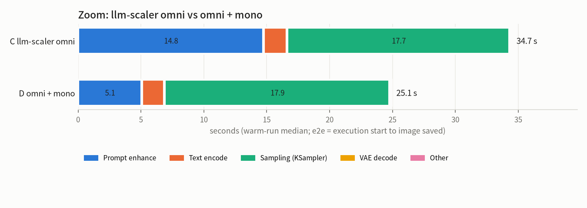
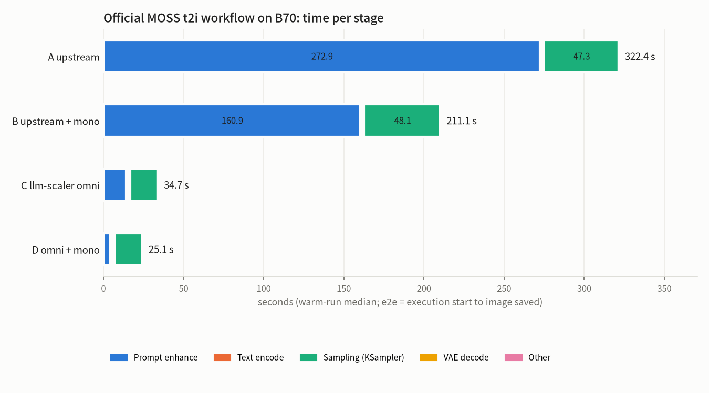

# comfy-mono-decode-xpu

Bit-exact decode kernels for ComfyUI prompt enhance (`TextGenerate` with MTP) on Intel XPU
(Xe2 / BMG, Arc Pro B70), for Qwen3.5-9B W4A8 text encoders.

The hooks sit at the model's decode step, so official workflows and templates speed up without new
nodes. Every replaced op is bit-identical to the eager kernel it replaces, and generated tokens match
the stock path exactly.

## Results

All numbers are from one Arc Pro B70 in the llm-scaler-omni 0.2.0-b3 ComfyUI image (see Requirements).

These 2026-11-11 showcase measurements predate the failure-recovery and cache-lifetime fixes.
The C/D performance comparison has not been rerun after those fixes.

### Official MOSS-Image text-to-image template: llm-scaler omni vs omni + mono

Workflow: the official `image_moss_image_t2i` template, unchanged except that the KSampler seed is
fixed to **42** (the template randomizes it). Prompt enhance uses the template defaults: Qwen3.5-9B
W4A8, `auto` MTP, sampling on. **C** uses ComfyUI-OmniXPU, Kitchen XPU and DynamicVRAM with mono
disabled (`MONO_DECODE_XPU=0`); **D** uses the same stack with mono enabled (now the default, or
explicitly `MONO_DECODE_XPU=1`). Each runs on a fresh server: one cold run, then three warm runs.
The warm runs change only the TextGenerate sampling seed (1, 2, 3; the same seeds for both
configurations), so prompt enhance and the image stages run again while the model loaders stay
cached.

**Mono does not change the output.** With the MTP tree fixed (`tree4s1m8`), C and D generate the
identical enhanced prompt (362 tokens, token sha `adaeae7bb8a40903`), and the images match to the eye.
What remains is the image stage's own run-to-run noise (PSNR 30.9 dB; two identical stock runs
give about 29 dB). D gets there faster: end to end 45.8 → 33.8 s, prompt enhance
18.6 → 6.9 s (cold runs).

| C llm-scaler omni, fixed tree | D omni + mono, fixed tree |
|---|---|
|  |  |

<details><summary>The shared enhanced prompt (C and D, fixed tree)</summary>

> Cinematic night street photograph of a model wearing an exaggerated balloon-sleeve white wool coat walking directly toward the camera. The model has a slender build, pale skin with a subtle 35mm film grain texture, and long dark hair that flows slightly in the evening breeze. Her posture is confident with shoulders back, one hand lightly brushing against the coat's sleeve while the other holds a small clutch close to her hip. She wears opaque black tights and chunky black leather ankle boots that click rhythmically on the wet asphalt.
> >
> > The scene is dominated by a huge illuminated theatre marquee towering above the street, its face packed with vintage-style bulbs spelling "MOSS" in tall, bold capital letters. The warm tungsten glow from the marquee casts a golden halo on the model's face and shoulders, contrasting sharply with the deep cold blue of the surrounding night sky. Long, distorted reflections of the marquee's lights stretch across the rain-slicked ground, creating a shimmering path of amber and gold beneath the model's feet.
> >
> > The composition utilizes a low camera angle to emphasize the height of the marquee and the imposing presence of the balloon sleeves. The background features blurred storefronts and distant streetlights that fade into the misty atmosphere, keeping the focus tight on the central figure and the glowing sign. The lighting is dramatic, with hard shadows falling behind the model against the wet pavement, enhancing the moody, noir aesthetic. The overall palette consists of high-contrast whites, deep blues, and rich amber tones, rendered with a grainy, analog film look that adds depth and texture to the entire image. The "MOSS" sign is positioned high in the upper frame, clearly readable against the dark sky, anchoring the scene in a specific urban location.

</details>

**Speed with the official defaults (`auto` MTP)**

| | C llm-scaler omni | D omni + mono | change |
|---|---|---|---|
| end to end, cold | 43.4 s | 32.7 s | -25% |
| end to end, warm median | 34.7 s | 25.1 s | **-28%** |
| prompt enhance, warm median | 14.8 s | 5.1 s | -66% |
| prompt-enhance decode | 22.5 tok/s | 106.9 tok/s | **4.75×** |
| sampling (KSampler), warm | 17.7 s | 17.9 s | unchanged |
| peak VRAM | 15.1 GB | 18.4 GB | +3.3 GB tile copy, freed after each generate |



Nearly all of the saved time is prompt enhance. Prompt-enhance seconds depend on how long the
enhanced prompt is (265–450 tokens across these runs). Decode tok/s normalizes output length, but context length and speculative-tree work still affect it.

Under `auto`, the enhanced prompt itself depends on speed. `auto` chooses the speculative tree from
measured draft and verify times (`best_widths` in ComfyUI's qwen35), and with sampling on the tree
shape decides how the seeded random stream is consumed. So C and D write different, equally valid
prompts here, while with the fixed tree above they are identical.

Images cannot be compared bit for bit, even within one configuration. Text encoding varies by
~2e-4 between identical calls, and sampling adds its own noise. The images are for visual
comparison only.

<details><summary>Reference: plain upstream ComfyUI with and without mono</summary>

A = `OMNIXPU_ENABLE=0 MONO_DECODE_XPU=0` (upstream ComfyUI + comfy-kitchen; upstream comfy-aimdo has no XPU
DynamicVRAM). B = A + `MONO_DECODE_XPU=1`. Both are slow, so they are reference only: A has one
warm run, and neither was run with the fixed tree.

| group | e2e cold | e2e warm (median) | prompt enhance warm | decode tok/s | sampling |
|---|---|---|---|---|---|
| A upstream | 388.2 s | 322.4 s | 272.9 s | 1.1 | 47.3 s |
| B upstream + mono | 163.3 s | 211.1 s | 160.9 s | 2.5 | 48.1 s |



In B, mono reproduces the OmniXPU numerics, not upstream eager, so its text differs from A's. Mono
also does not replace upstream's other eager parts (lm_head, draft block, embedding), so the B speedup
is limited. Sampling takes about 48 s instead of 18 s because upstream lacks OmniXPU's UNet kernels.

All four groups, official `auto` MTP, cold run (TextGenerate sampling seed 0, KSampler seed 42):

| A upstream | B upstream + mono |
|---|---|
|  |  |
| **C llm-scaler omni** | **D omni + mono** |
|  |  |

The four enhanced prompts describe the same scene, but they are not identical, so the image details
differ. Under `auto` the tree follows each configuration's speed, and the upstream and OmniXPU kernels
also differ numerically. C and D with the fixed tree, at the top of this section, are the
like-for-like comparison.

</details>

### TextGenerate decode alone

Same image, `qwen3.5_9b_w4a8_gptq.safetensors`, three prompts (base / giant / adult), decode tok/s:

| mode | stock image | mono_decode_xpu | tokens |
|---|---|---|---|
| fixed tree `tree4s1m8`, resident weights | 28 / 30 / 30 | 81.5 / 95.6 / 91.2 | identical |
| fixed tree `tree4s1m8`, DynamicVRAM (default) | — | 80.3 / 93.8 / 89.6 | identical |
| official `auto` MTP, DynamicVRAM (default) | 23.5 / 21.8 / 24.2 | 93.2 / 100.3 / 106.8 | see note |

Note on `auto`: the adaptive tree reshapes itself from measured step times, so the accepted token
paths depend on speed. Exactness is therefore verified on fixed trees: the token sha256 equals the
stock image's for every prompt.

## Requirements

The base `intel/omix` image does **not** include ComfyUI. Everything here was built and measured in
the **llm-scaler-omni 0.2.0-b3 ComfyUI image for BMG**. That image is based on
`intel/omix:0.4.1-devel-ubuntu24.04` and adds ComfyUI and the XPU components below. Any environment
with the same components should behave the same.

`0.2.0-b3` is not published as an image; it exists only as a source build. To reproduce the tested
environment, build it from [intel/llm-scaler](https://github.com/intel/llm-scaler) at commit
`210b4ce991eb0ef3b0ad4c0c9f38b9806fb7e918`, following `omni/README.md`:

```bash
git clone https://github.com/intel/llm-scaler && cd llm-scaler
git checkout 210b4ce991eb0ef3b0ad4c0c9f38b9806fb7e918
cd omni && OMNI_IMAGE_REPOSITORY=llm-scaler-omni XPU_TARGET=bmg bash build.sh
# -> llm-scaler-omni:0.2.0-b3-comfyui-bmg
```

The published image `intel/llm-scaler-omni:0.2.0-b2` is older and has not been tested with this node.

| component | tested version | needed for |
|---|---|---|
| GPU | Intel Arc Pro B70 (Xe2 / BMG) | AOT target `bmg` by default; `--target` builds for another Xe2 device |
| ComfyUI | v0.43.0 (Comfy-Org, `426f5eea`) | the Qwen3.5 `TextGenerate` MTP decode path the hooks attach to |
| torch | 2.14.0+xpu, Python 3.12 | runtime |
| oneAPI DPC++ (`icpx`) | 2026.1.1 | building only (`install.py` sources `setvars.sh` if needed) |
| ComfyUI-OmniXPU | 0.2.0-b3 | bit-exact reference (see below) |
| comfy-kitchen + comfy-kitchen-xpu-runtime | 0.2.40 + 0.2.40 | bit-exact reference |
| comfy-aimdo + comfy-aimdo-xpu-runtime | 0.6.0 + 0.6.0 | DynamicVRAM on XPU |
| omni_xpu_kernel | 0.2.0b3 (torch 2.14, bmg) | bit-exact reference |

The kernels reproduce the OmniXPU / Kitchen XPU kernels bit for bit; that is the stack the
"identical tokens" claim refers to. Without OmniXPU (plain upstream ComfyUI + comfy-kitchen), the
node still installs and speeds up decode. The tokens then follow the OmniXPU numerics, not the
upstream eager kernels, and upstream comfy-aimdo has no XPU DynamicVRAM (results, groups A/B).

## Install

Install it like any custom node, into `ComfyUI/custom_nodes/`, using ComfyUI's Python environment.

**ComfyUI-Manager.** Install from the Git URL
`https://github.com/xiangyuT/comfy-mono-decode-xpu`. Manager clones the repo and runs `install.py`,
which builds the kernels.

**By hand:**

```bash
cd ComfyUI/custom_nodes
git clone https://github.com/xiangyuT/comfy-mono-decode-xpu
cd comfy-mono-decode-xpu
python install.py            # or ./install.sh; use ComfyUI's python
```

`install.py` builds `comfy_mono_decode_xpu/_C*.so` in place. The build is a single icpx invocation
and takes a few minutes. It is skipped when the extension is newer than every source. If `icpx` is not
on `PATH`, oneAPI's `setvars.sh` under `ONEAPI_ROOT` (default `/opt/intel/oneapi`) is sourced.

The script never fails the install. Without a compiler or an XPU, it explains what is missing and
exits. ComfyUI still starts, and the node logs that it is inactive.

Options:
- `--force`: rebuild.
- `--target DEVICE`: AOT device name (default `bmg`).

There are no extra Python dependencies; torch (XPU) comes from the ComfyUI environment.
After `git pull`, rerun `python install.py`: a changed source triggers a rebuild.

Build only through `install.py` / `build_icpx.sh`, not `pip install`. torch's SyclExtension compiles
each file separately and device-links afterwards, and that produced different device code for
identical source. The kernels are validated bit-exact against the single-invocation build only.

## Use

```bash
python main.py ...
```

The recommended stack is enabled by default. Set `MONO_DECODE_XPU=0` to disable it.
The log should show `[mono_decode_xpu] layer installed=True`. Both resident (`--gpu-only --disable-dynamic-vram`) and
the default DynamicVRAM mode are supported. Calls the kernels do not cover fall back to the original
code. These include prefill, other quantizations, LoRA weight functions, and batch size above 1.
A failed pure operation is logged and disabled before trying the stock operation. After a dispatch
that may have changed KV, recurrent state or the input in place, the error is propagated without
replaying the layer. Cancellation propagates without disabling the kernels.

ComfyUI builds with `CombinedLinear` expose a projection interface this version has not adapted:
the MLP/layer hooks stay off with a warning. The tested interface is the v0.43.0 stack above.
See [tests/README.md](tests/README.md) for unit tests and model validation through the ComfyUI UI.

Normal use requires no environment variables. The pieces below can be set one by one, mainly for
A/B tests. An explicit `1` or `0` on a piece wins over the master switch: for example,
`MONO_DECODE_XPU=1 MONO_DECODE_XPU_W4=0` runs the recommended stack without the W4 linear.

| variable | when unset | effect |
|---|---|---|
| `MONO_DECODE_XPU` | on | Master switch: `0` disables the four pieces below unless a piece is explicitly enabled |
| `MONO_DECODE_XPU_LAYER` | same as `MONO_DECODE_XPU` | The main speedup. Decode layers run in persistent kernels, with the attention port, fused RoPE + KV write and fast draft top-k/argmax. |
| `MONO_DECODE_XPU_MONO` | same as `MONO_DECODE_XPU` | Fallback: one-launch MLP block for decode rows that miss the layer path |
| `MONO_DECODE_XPU_W4` | same as `MONO_DECODE_XPU` | Fallback: fused small-M W4A8 linear for linears outside the layer kernels |
| `MONO_DECODE_XPU_PREP` | same as `MONO_DECODE_XPU` | Fallback: ConvRot rotate + INT8 quantize in one launch |

All switches, including per-part A/B toggles: [docs/ENV.md](docs/ENV.md).

## How it works

A decode step verifies up to 8 tree rows through 32 layers, then drafts the next tree with the
MTP head. Per verify layer:

- **Gated-DeltaNet layers (24):** one persistent launch covers input norm, ConvRot quantize, W4A8
  projections, deferred conv, gates, delta rule and gated norm. A second launch, `layer_post`, covers
  the out projection, residual, post norm, MLP and residual.
- **Full-attention layers (8):** `layer_pre`, then eager q/k norm, then `rope_kv` (fused partial RoPE
  plus KV write), then `attn_core` (one-launch tree attention), then `layer_post`.
- **MTP draft:** the BF16 draft block's attention uses the same `rope_kv` / `attn_core`. Top-k and
  argmax over the 248k-vocab logits run in one launch with torch's exact tie order.

The persistent kernels stream W4 weights through a GEMV engine with device-wide grid barriers. The
engine uses an exact FP8 group-scale pair table and int32 split-K, and reproduces the reference
reduction order. Under DynamicVRAM, each linear's weight comes from comfy's VBAR cast every call. A
per-generate tile-major copy, made while there is VRAM headroom, keeps the fast layout.

Details, exactness method and measurements: [docs/DESIGN.md](docs/DESIGN.md).

## Layout

```
__init__.py              ComfyUI entry point (env-gated install, adds no nodes)
comfy_mono_decode_xpu/   routing: layer.py (layers, attention, RoPE, sessions), logits.py (picks),
                         mono.py (MLP block), patch.py (W4 linear, rotate+quant), graph_step.py (experimental)
csrc/                    SYCL kernels (see docs/DESIGN.md) and bindings
install.py / install.sh  build the extension in place (ComfyUI-Manager runs install.py)
build_icpx.sh            the single-invocation icpx build
pyproject.toml           Comfy Registry metadata
THIRD_PARTY_NOTICES.md   third-party sources and licenses (full texts in licenses/)
tests/                   no-model pytest unit tests; UI model-validation instructions
```

## Limits

- Batch 1, 1–8 decode rows, and the Qwen3.5-9B shapes (hidden 4096, head dim 256).
- Packed W4A8 G16 with FP8 group scales, ConvRot 256 and one shared codebook. Anything else falls back.
- Both resident and DynamicVRAM modes own tile copies for one generate call. After prefill, the
  decision uses the actual packed storage size, allocator pool, inference reserve and free-memory
  margin. VBAR model residency is budgeted outside Torch's pool. If copies do not fit, the kernels
  read the original row-major weights. Copies, graph references and component weight caches are
  released on return or error without flushing Torch's global cache.
- Single XPU device per process.

## License

Apache License 2.0, see [LICENSE](LICENSE). `csrc/attn_port.sycl` and `csrc/mono_gdn.sycl` contain code
ported from MIT-licensed Strata kernels (through intel/llm-scaler). See [THIRD_PARTY_NOTICES.md](THIRD_PARTY_NOTICES.md) and
[licenses/](licenses/).
